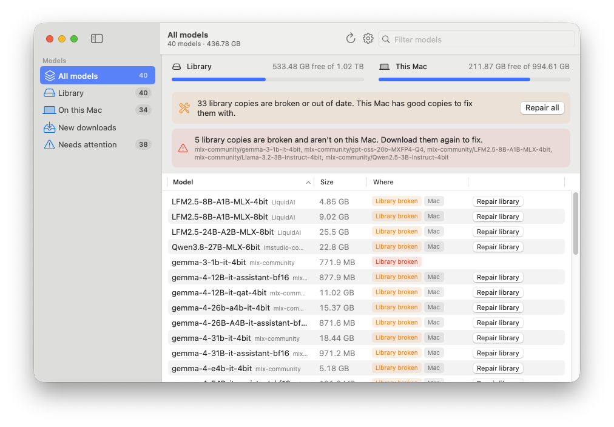

# Model Shelf

A macOS app for people who run local models and keep running out of disk. It treats an external
drive as your **model library** and the Hugging Face cache (`~/.cache/huggingface/hub`) as a
**staging area**: models download to the cache, you back them up to the library, and you copy them
back when you want to run them again.

Model Shelf knows the cache layout, so models keep working after they're copied. Every copy is
verified, and a model leaves this Mac only when you choose **Remove from Mac**.



## Why not just rsync?

Each model in the cache is a folder like `models--mlx-community--Qwen3-4B-4bit` with three parts:
`blobs/` holds the data, `snapshots/<commit>/` holds the file names as **symlinks** into
`../../blobs`, and `refs/` maps branches to commits. Copying with `rsync -r` (without `-l` or `-a`)
skips those symlinks. You get every byte of the weights, but nothing in `snapshots/`, so no library
can load the copy. Model Shelf finds copies damaged this way and repairs them.

## Features

- **One table for both places.** Each model shows where it is (library, this Mac, or both), its
  size, and whether each copy is healthy.
- **Back up to library.** Copy a new download to the drive and verify it. The Mac copy stays.
- **Copy to Mac.** Bring a model back to the cache to use it. The library copy stays.
- **Remove from Mac.** Allowed only when the library copy is healthy, holds every revision, blob and
  snapshot file the Mac copy has, and every one of those files on the drive passes its hash check.
- **Repair or update the library** from a good Mac copy. Files already on the drive are checked
  and kept, so only what's missing or damaged is copied.
- **Redownload** a broken library copy that isn't on this Mac, through the
  [LocalLM SDK](https://github.com/ancientcomputing/locallm), at the exact revision you had.
- **Drag and drop** models onto *Library* or *On this Mac* in the sidebar.
- **Activity log** of every backup, copy, repair, removal and download, with revisions.
- Storage bars for both disks, and banners for new downloads and copies that need attention.

## Requirements

- macOS 27 on Apple silicon (the LocalLM SDK's download support needs macOS 27)
- Xcode 27 / Swift 6.4 to build
- A library drive formatted APFS or Mac OS Extended. exFAT can't store symlinks.

## Install

Download `ModelShelf-<version>.dmg` from
[Releases](https://github.com/ancientcomputing/modelshelf/releases), open it, and drag
**Model Shelf** to Applications. The app is signed with a Developer ID and notarized by Apple.

## Build and run

```bash
./build-app.sh            # builds build/ModelShelf.app
./build-app.sh --install  # also copies it to /Applications
open build/ModelShelf.app
```

The build fetches the LocalLM SDK frameworks from the
[v3.0.0-GA release](https://github.com/ancientcomputing/locallm/releases/tag/v3.0.0-GA), checks
them against the published checksums, and bundles them into the app.

The first time it opens, choose your library folder in **Settings** (⌘,). The library is a hub
folder: it contains `models--org--name` folders, just like the cache. The cache location follows
`HF_HUB_CACHE` or `HF_HOME` if you set them.

## How it keeps your models safe

[docs/data-safety.md](docs/data-safety.md) lists every action and situation, what each can change,
and the test that covers it.

- **Only two actions delete.** **Remove from Mac** deletes this Mac's copy, and only after reading
  the library's copy back and checking every file against its hash. **Delete from library** asks
  first. Nothing else removes a model, a revision or a file.
- **Backups add, they don't replace.** Backing up, updating, repairing and restoring merge into the
  copy that's already there. A copy keeps every revision it had, even ones the other side doesn't
  have, so two Macs can share one library drive. `refs/main` keeps pointing where it did unless
  that revision is missing or broken. The one exception: a file that fails its hash check is
  damaged, and is replaced with a verified copy.
- **Verify before it lands.** Each new file is written to a hidden staging folder, hashed (SHA-256)
  and compared with the source, then moved into place. Files already in the destination are
  checked against their hash before they're kept. If anything fails or you cancel, the staging
  folder is deleted and both copies keep everything they had.
- **Symlinks stay symlinks.** Snapshot links are recreated exactly, so the copy works wherever it
  lands.
- **No page-cache flooding.** Large files are copied with `F_NOCACHE`, so copying 40 GB doesn't
  push everything else out of memory.
- **Downloads in progress are left alone.** A model with `.incomplete` files in `blobs/` can't be
  copied, and nothing is copied into one.
- **Health checks look at what loaders need.** A copy is healthy only when its snapshots contain
  real model files and every link resolves. Hidden marker files such as
  `.locallm-download-complete` don't count.

## Redownloading

A redownload goes straight into the library:

1. **Pick the revision.** In order: the commit the library copy was at, the Mac copy's commit, a pin
   recorded by a LocalLM Lab app (`~/Library/Application Support/<app>/mlx-pins.json`), or the
   latest on `main`. The confirmation shows which one and where it came from, and offers
   *Download latest instead*. A branch name is resolved to a commit once, before anything
   downloads.
2. **Reuse what's on the drive.** Blobs already in the library are checked against Hugging Face's
   hashes and linked. Blobs that fail the check are deleted.
3. **Download the rest** with the SDK's
   `MLXModelProvider(cacheDirectory:pinnedRevisions:).download(_:)`, which verifies what it
   fetches, resumes interrupted files and writes its completion marker.
4. **Check the result.** Every file the SDK delivered is hashed again before the model counts as
   repaired.

Gated models need a Hugging Face token, in `HF_TOKEN` or saved with `hf auth login`.

## Activity log

Every action is written to `~/Library/Application Support/ModelShelf/activity.jsonl`, one JSON
object per line. Each entry records the time, action, model, revision (and for downloads, where the
revision came from), bytes copied, downloaded or freed, duration, and whether it succeeded, failed
or was cancelled. The **Activity** view in the sidebar shows the same log.

```bash
jq -r '[.date, .action, .repoID, .revision] | @tsv' ~/Library/Application\ Support/ModelShelf/activity.jsonl
```

## Development

```
Sources/ShelfCore       scanning, health checks, copy/verify/merge, pins, activity log (no SDK)
Sources/ShelfDownload   redownloads through the LocalLM SDK
Sources/ModelShelf      the SwiftUI app
Tests/                  XCTest suites
```

`swift test` runs the engine tests against temporary folders. Two end-to-end tests are opt-in:

```bash
# Real copy across volumes: reads one repo (never modified), uses two scratch folders it deletes.
MODELSHELF_E2E_SRC=~/.cache/huggingface/hub/models--org--small-model \
MODELSHELF_E2E_DST=/Volumes/YourDrive/.modelshelf-e2e \
MODELSHELF_E2E_BACK=/tmp/modelshelf-e2e-back \
swift test --filter CrossVolumeTests
```

```bash
# Real download through the SDK (~12 MB public test repo) into a scratch folder.
MODELSHELF_NET_E2E=/tmp/modelshelf-net swift test --filter SDKDownloadTests
```

### Releasing

`packaging/release.sh` builds a release DMG in `build/release/`. It signs the app and the bundled
SDK frameworks with a Developer ID (hardened runtime, secure timestamp), notarizes and staples the
app, then builds, signs, notarizes and staples the DMG, and writes a `.sha256` next to it.

```bash
VERSION=1.0.0 packaging/release.sh
```

Set `SIGN_IDENTITY` and `NOTARY_PROFILE` (a `xcrun notarytool store-credentials` profile) to use
your own certificate.

### Sandboxed / Mac App Store build

The Mac App Store requires the App Sandbox. `SANDBOX=1 ./build-app.sh` signs the app with
[`packaging/ModelShelf.entitlements`](packaging/ModelShelf.entitlements): sandbox, network access,
and read-write access only to folders you choose. On first run it asks for the Hugging Face cache
and the library folder, and keeps access to them with security-scoped bookmarks, including a
library on a drive that's ejected and plugged back in. Choose `~/.cache/huggingface` (not just
`hub`) so gated models can use your saved token. Inside the sandbox the app can't read other apps'
LocalLM Lab pin files, so redownloads use the commit of the library or Mac copy, or the latest.

`packaging/release-mas.sh` builds the App Store package: sandboxed, signed with Apple Distribution,
provisioning profile embedded, and a `.pkg` signed with the installer certificate. The one-time
Apple Developer portal setup it needs is described at the top of the script.

To point the app at test folders without changing your settings, set `MODELSHELF_CACHE` and
`MODELSHELF_LIBRARY` when launching it.

### App Store screenshots

`packaging/screenshots/capture.sh store` takes the five App Store screenshots (1440 × 900, no
alpha) from a demo library: 15 models whose weights are sparse files, so they show real sizes
but take under 1 MB on disk. `capture.sh review` takes the App Review shots of the sandboxed
folder setup; you click through the two folder pickers when it asks. Quit Model Shelf first. The
demo runs with `MODELSHELF_DEMO`, which uses fixed disk numbers and its own activity log and
saves nothing to your settings. Output goes to `build/screenshots/`.
`make_demo_library.py --tiny --scenario review` builds a small library to zip for reviewers.

## Support and privacy

Help, common fixes and contact details: [SUPPORT.md](SUPPORT.md), or
[thisbrain.ai/opensource/support.html](https://thisbrain.ai/opensource/support.html#modelshelf).
Model Shelf collects no data; see [PRIVACY.md](PRIVACY.md) and the
[full policy](https://thisbrain.ai/opensource/privacy.html#modelshelf).

## License

Apache 2.0. See [LICENSE](LICENSE).
